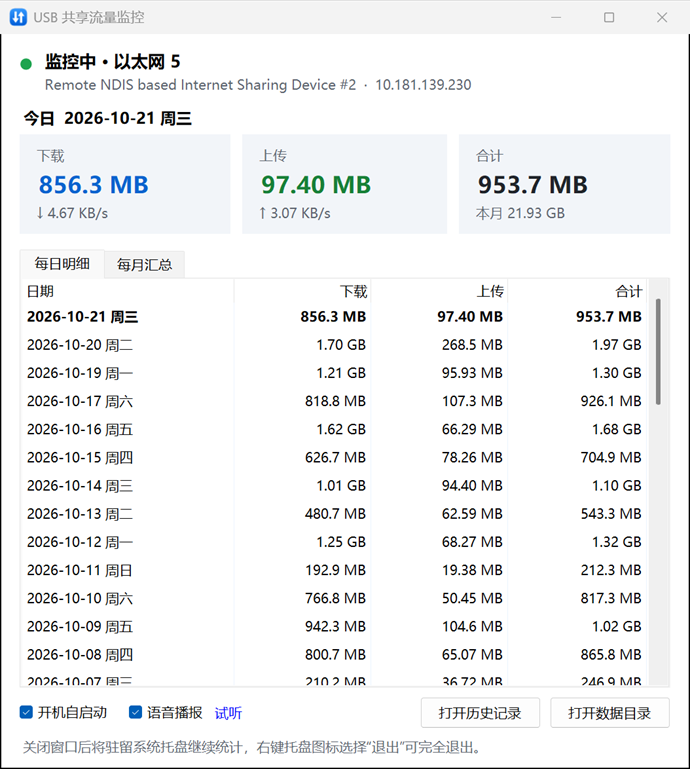
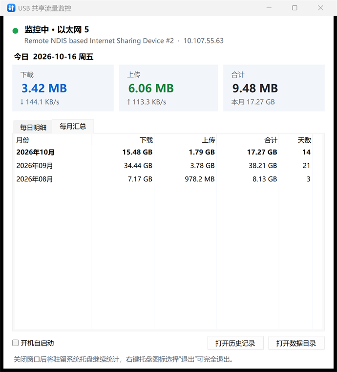

# USB 共享流量监控 · MobileUSB_wwwshare

Windows 11 托盘小工具：实时统计电脑通过 **手机 USB 网络共享** 消耗的流量，按自然日累计并永久保存历史。

> A lightweight Windows 10/11 tray app that auto-detects your phone's USB-tethering adapter (RNDIS / NCM / iPhone),
> tracks upload/download traffic in real time, keeps per-day totals with full history (CSV), minimises to the tray
> and can start with Windows. Single ~100 KB exe on the built-in .NET Framework 4.8, no runtime to install.

| 每日明细 | 每月汇总 |
| --- | --- |
|  |  |

<sub>截图中的历史数据为演示数据。</sub>

## 特点

- **自动识别手机共享网卡**：不依赖“以太网 5”这类会变化的接口名称，重连、换 USB 口、改名后照样能识别
- **按自然日累计**：0 点自动切换到新的一天，可查看每日明细和每月汇总，完整历史导出为 CSV
- **托盘常驻**：点 × 最小化到托盘，右键托盘图标选择“退出”才会真正关闭，支持开机自启动
- **轻量**：单文件 exe 约 100 KB，基于 Windows 自带的 .NET Framework 4.8，无需安装运行时，后台 CPU 占用几乎为 0
- **隐私**：程序不联网、不上传任何数据，所有记录只保存在本机

## 下载与安装

1. 在 [Releases](https://github.com/Anna-SAP/MobileUSB_wwwshare/releases) 下载 `UsbShareMonitor.exe`，或按下文[从源码编译](#从源码编译)。
2. 把 exe 放到一个固定位置（例如 `D:\Tools\`），双击运行。
3. 系统要求：Windows 10 / 11（自带 .NET Framework 4.8）。

## 使用

1. **首次运行**时，如果网卡上已经有流量（本次连接以来的累计），程序会询问是否计入今天。
2. 勾选窗口左下角的 **开机自启动**（托盘右键菜单里也有）。开机后程序直接以托盘方式启动，不弹窗口。
3. 点窗口右上角 **×**：窗口隐藏，程序驻留在右下角托盘继续统计。
   - 左键单击托盘图标：重新打开窗口（再次双击 exe 效果相同，不会启动第二个实例）
   - 右键托盘图标 → **退出**：保存数据并完全退出
   - Windows 11 默认可能把新图标收进 **^** 折叠区，可以把它拖到任务栏上常驻显示
4. 托盘图标为 **蓝色** 表示已检测到 USB 共享网卡，**灰色** 表示未连接。鼠标悬停可看到今日用量。

## 识别规则（应对“以太网 5 / 网络 7”等名称变化）

程序 **不依赖接口名称**。每 5 秒（以及网络变化时立即）扫描一次所有网卡，满足以下任一条件即视为 USB 共享网卡：

- 网卡描述包含关键词，例如 `Remote NDIS based Internet Sharing Device #2`
- 硬件 ID 包含关键词，例如 `USB\VID_04E8&PID_6863&RNdis\...`

默认关键词：`Remote NDIS;RNDIS;UsbNcm;Apple Mobile Device Ethernet`，覆盖三星等安卓手机的 RNDIS、较新安卓手机的 NCM 以及 iPhone。
如需修改，请先退出程序，再编辑 `data.ini` 中 `[settings]` 段的 `keywords=`（用 `;` 分隔）。

计数按网卡 GUID 分别跟踪，以下情况都能正确累计，不会重复计算或丢失：

| 情况 | 处理方式 |
| --- | --- |
| 拔线重插、手机关闭再开启共享（网卡重建，计数归零） | 新连接的流量从 0 开始计入 |
| 电脑重启 / 睡眠唤醒 | 识别出计数已重置，照常累计 |
| 程序退出期间仍在上网 | 下次启动时补记这段流量（同一连接未断开的情况下） |
| 跨过 0 点 | 0 点后的流量自动记到新的一天，前一天写入“日结”日志 |

## 数据文件

位置：`%LOCALAPPDATA%\UsbShareMonitor\`（窗口里点 **打开数据目录** 即可打开）

| 文件 | 内容 |
| --- | --- |
| `daily_traffic.csv` | **完整的每日历史**（日期、星期、下载/上传/合计的字节数和易读值），可直接用 Excel 打开 |
| `data.ini` | 程序的主数据（设置、网卡计数基准、每日累计），原子写入，并保留一份 `.bak` 备份 |
| `events.log` | 事件日志：启动/退出、网卡连接/断开、每日日结。超过 1 MB 时自动轮换为 `events.old.log` |

每 30 秒以及退出、关机、睡眠前都会保存一次，意外断电最多丢失约 30 秒的数据。
即使 Excel 正打开着 CSV，主数据也照常保存，CSV 会在 Excel 关闭后自动补齐。

## 统计口径

- 统计的是电脑经过 USB 共享网卡收发的全部字节，**包括 VPN 的加密封装流量**，因为它们最终也走这块网卡。
- 不包含手机自身 App 产生的流量。
- 网卡计数包含以太网帧头等开销，和运营商的计费值会略有出入（通常略高一点）。单位按 1024 进位（1 GB = 1024 MB）。

## 命令行参数

| 参数 | 作用 |
| --- | --- |
| `--tray` | 启动时不显示窗口，直接驻留托盘（开机自启动时使用） |
| `--exit` | 让正在运行的实例保存数据后退出 |
| `--data <目录>` | 使用指定的数据目录（便携模式或测试用） |

## 卸载

取消勾选“开机自启动”，从托盘菜单退出，然后删除 exe 和 `%LOCALAPPDATA%\UsbShareMonitor` 目录。

## 从源码编译

需要 Visual Studio 或 *Build Tools for Visual Studio*（提供 Roslyn `csc.exe`），然后执行：

```powershell
.\build.ps1
```

输出到 `dist\UsbShareMonitor.exe`。源码结构：

- `src\AdapterMonitor.cs`：识别网卡，并把原始计数换算成增量（处理重连、计数重置）
- `src\TrafficStore.cs`：每日数据、`data.ini` / CSV / 日志的读写
- `src\TrayApp.cs`：托盘图标、1 秒定时采样、跨日、保存、关机/睡眠处理
- `src\MainForm.cs`：主窗口界面
- `src\AutoStart.cs`：开机自启动（`HKCU\...\Run`，无需管理员权限）
- `src\AppIcon.cs`：用代码绘制的图标

## 许可证

[MIT](LICENSE) © 2026 Anna Su：可自由使用、修改和分发，需保留版权声明；软件按“现状”提供，不附带任何担保。
